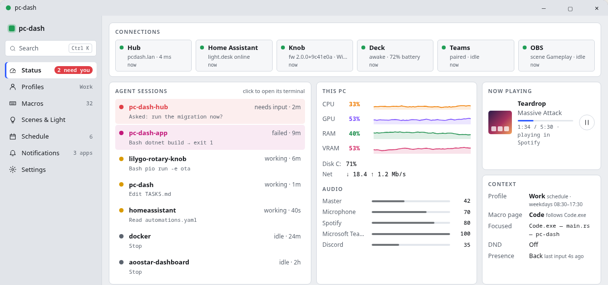
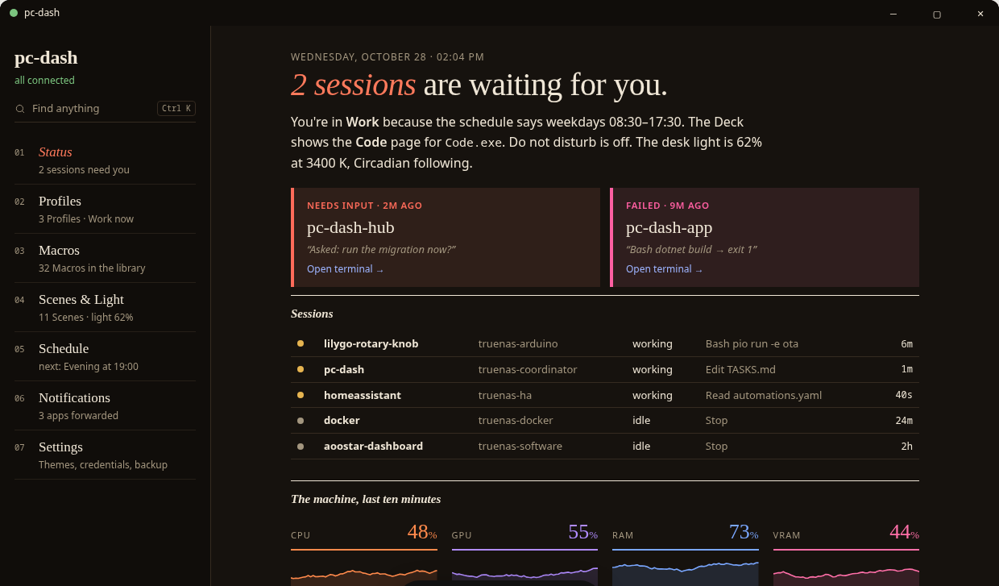
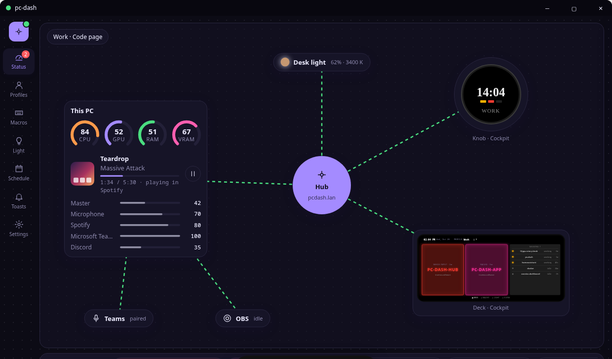
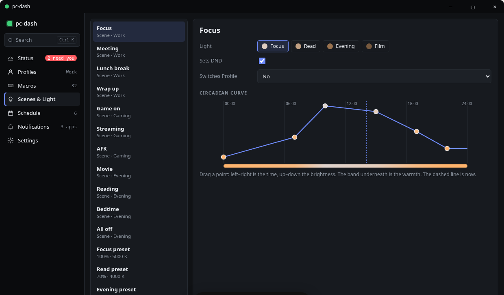
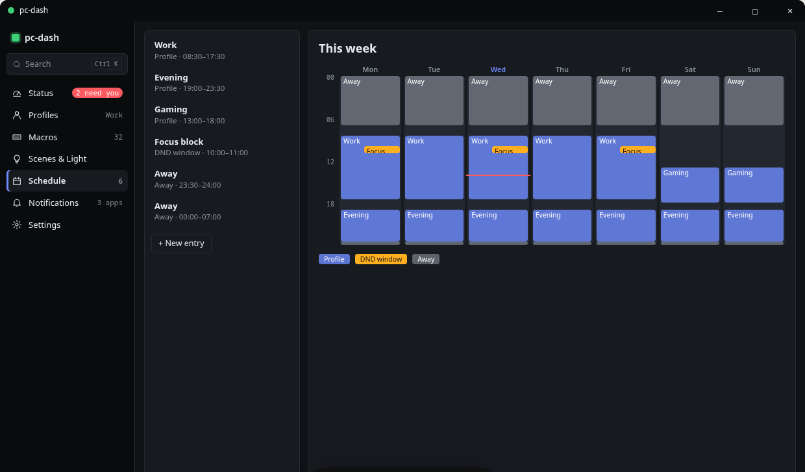
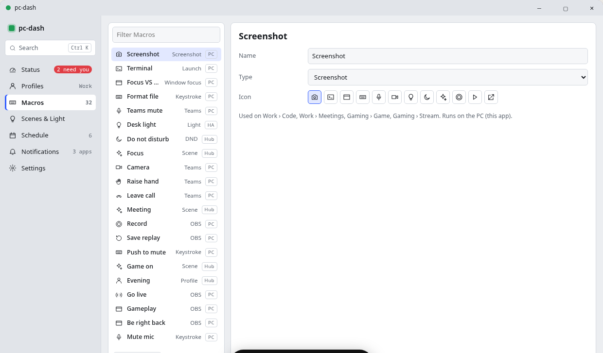
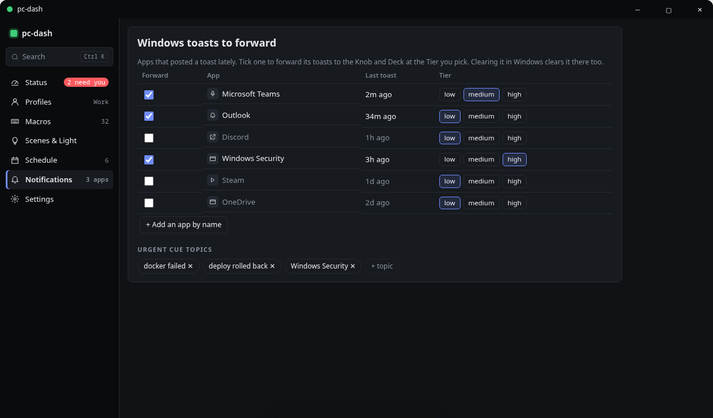
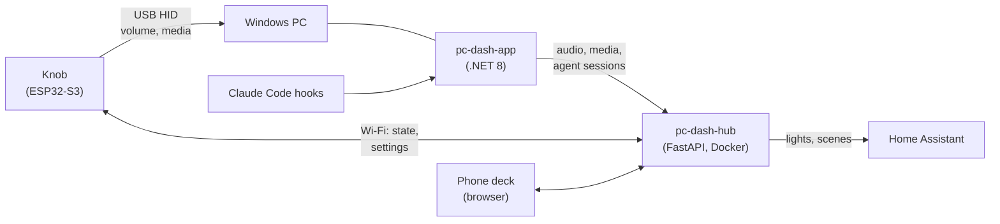

# PC Dash App


A lightweight Windows companion app (.NET 8, WPF) for the PC Dash knob. It reads the PC's real
audio, media and activity state and reports it to the hub, so the knob shows live values
instead of placeholders. It also forwards **Claude Code** session events so the knob can show
when an agent is working or waiting on you.



<sub>Design prototype of the next version of the app window.</sub>

Part of the **PC Dash** family:

| Repo | Role |
|---|---|
| [lilygo-rotary-knob](https://github.com/btkramer/lilygo-rotary-knob) | The knob: ESP32-S3 firmware with a round AMOLED display |
| [pc-dash-hub](https://github.com/btkramer/pc-dash-hub) | Self-hosted hub (FastAPI + Docker) that relays state, settings and smart-home actions |
| **pc-dash-app** (this repo) | Windows companion app |

## The v2 window

The next version of the app becomes the control center for the whole system: sessions,
profiles, macros, lighting, schedules and notification forwarding. It's prototyped in three
looks that follow Windows light/dark mode.

| | |
|:---:|:---:|
|  |  |
| **Almanac**: an editorial status page that reads like a briefing | **Desk map**: the whole setup as a live diagram |
|  |  |
| **Scenes & Light**: drag the circadian brightness/warmth curve | **Schedule**: profiles and DND windows across the week |
|  |  |
| **Macros** (light mode): a library shared with the deck | **Notifications**: pick which Windows toasts reach the knob and deck, and at what tier |

<sub>From the interactive v2 design prototype.</sub>

## The PC Dash system



## What it does

- **Volume and mute** from Windows Core Audio (NAudio)
- **Now playing**: track, artist, playback state and source app, via the Windows System Media
  Transport Controls (SMTC). Browser sources are resolved to the actual tab or site
- **Presence**: keyboard/mouse idle time, so the knob can tell "PC on" from "someone is here"
- **Agent sessions**: `PcDashApp.HookForwarder` is a tiny executable you register as a
  [Claude Code hook](https://docs.anthropic.com/en/docs/claude-code/hooks). It maps hook
  events to session states (working, needs input, done) and publishes them to the hub
- **Project logos**: assign a logo or a generic icon to each project, so agent-session tiles
  are easy to recognize at a glance. Assignments are stored on the hub
- Small status window showing hub connection, last sync and live values

## Building

Requires the .NET 8 SDK on Windows 10 (19041) or later.

```powershell
dotnet build src/PcDashApp -c Release
dotnet build src/PcDashApp.HookForwarder -c Release
```

Configure `src/PcDashApp/appsettings.json`:

```json
{
  "HubBaseUrl": "http://your-hub:8015",
  "DeviceId": "t-encoder-pro",
  "ReportIntervalMs": 5000,
  "PollIntervalMs": 1000
}
```

Smoke tests for the hub client, the hook forwarder and logo rendering are in `test/`.

## Docs

| File | Contents |
|---|---|
| `SETTINGS_SCHEMA.md` | The shared settings document synced through the hub |
| `HOOKS_SCHEMA.md` | Agent-session wire format and Claude Code hook mapping |
| `LOGO_SCHEMA.md` | Project-logo storage and assignment |
| `MACROS_SCHEMA.md` | Macro definitions (planned phone macro deck) |
